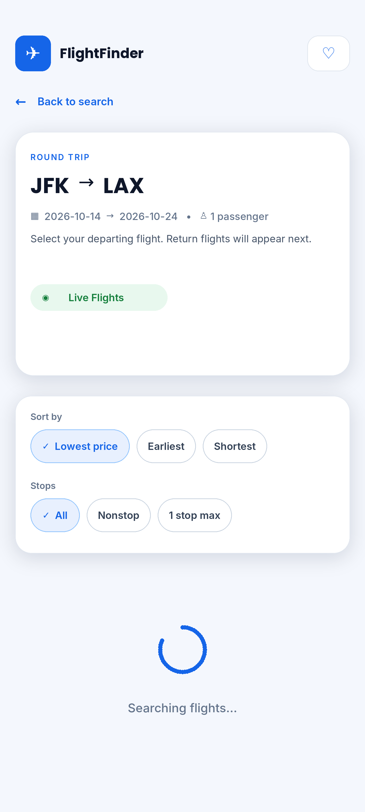
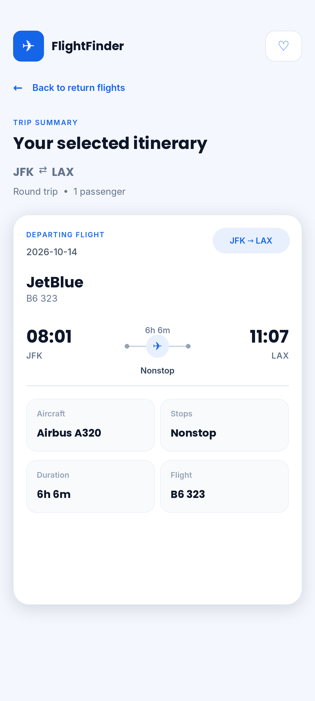

# ✈️ Flight Finder

A React Native mobile app that lets users search for flights by travel dates and requirements, choose their departing and return flights, and review a trip summary, with real-time flight results from integrated APIs.

> **Note:** This app was built for Sky Premia LLC, so the source code is private. This page shows the app's features, tech stack and screenshots.

## Screenshots

<table align="center">
  <tr>
    <td align="center"> Home</td>
    <td align="center"> Search form</td>
    <td align="center"> Searching flights</td>
  </tr>
  <tr>
    <td align="center"> Departing flights</td>
    <td align="center"> Choose return flight</td>
    <td align="center"> Trip summary</td>
  </tr>
</table>

## Features

- Search flights by travel dates and requirements
- Real-time flight information retrieved through API integration
- Browse departing flights and choose a return flight
- Trip summary screen to review the selected flights
- Clean, mobile-friendly interface

## Tech Stack

## My Role

Mobile App / Front-End Developer. I built the app's front end and integrated APIs to power the dynamic flight search results.

## Contact

[LinkedIn](https://www.linkedin.com/in/sundas-maria-hayat-1851a131a) · sundasmaria09@gmail.com
